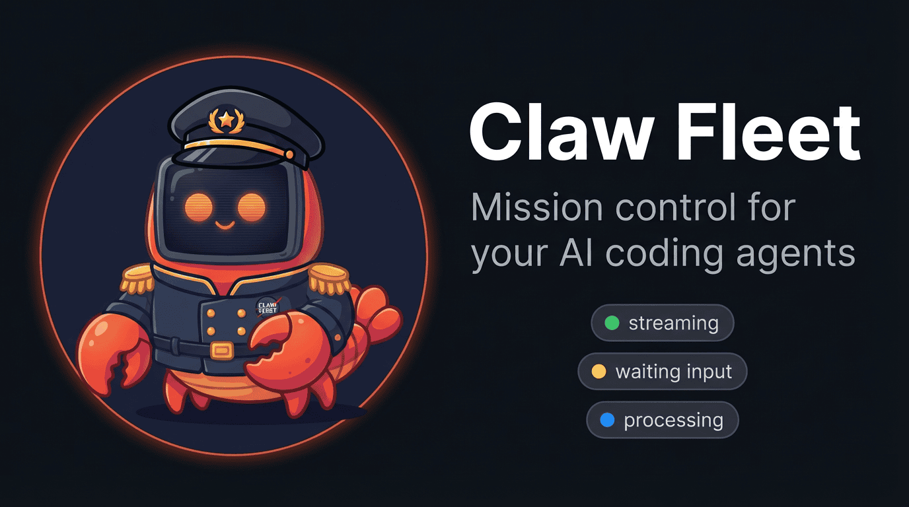

<div align="center">



# Claw Fleet

**Hand each idea to one coordinator. Every project moves at once. You're only called when you're needed.**
Each task is one conversation with a coordinating agent — **Claude Code**, **Codex** or **DeepSeek Harness** — that does small things itself, proposes a split before fanning out sub-tasks, and reports back to you alone. Everything runs on your own machine, every step stays visible, and the calls that need you land in one queue you can answer from your phone.

**[Explore the workspace](https://hoveychen.github.io/claw-fleet/)** · **[中文介绍](https://hoveychen.github.io/claw-fleet/zh/)**

[](https://github.com/hoveychen/claw-fleet/releases/latest)
[](LICENSE)
[%20%7C%20Mobile-lightgrey?style=flat-square)](https://github.com/hoveychen/claw-fleet/releases/latest)

</div>

---

## 1. Install

**Prerequisite:** [Claude Code](https://claude.com/claude-code) (`claude` CLI) installed, with at least one session already run — Claw Fleet reads the session files it writes. Codex is optional and can be enabled in Settings.

### macOS / Windows — desktop app

| | Platform | Download |
|---|---|---|
|  | macOS (Intel + Apple Silicon) | [claw-fleet-macos.pkg](https://github.com/hoveychen/claw-fleet/releases/latest/download/claw-fleet-macos.pkg) |
|  | Windows x64 / ARM64 | [claw-fleet-windows-x64-setup.exe](https://github.com/hoveychen/claw-fleet/releases/latest/download/claw-fleet-windows-x64-setup.exe) |

Download, open, done. No server, no API key, no signup.

###  Linux — web UI

Linux runs the same UI in your browser instead of a native bundle. The UI is compiled into the Linux binary, so it's one download:

```bash
curl -L -o fleet https://github.com/hoveychen/claw-fleet/releases/latest/download/fleet-linux-x64
chmod +x fleet && sudo mv fleet /usr/local/bin/

fleet webui
```

Open **http://127.0.0.1:4571**. A phone on the same machine's URL gets the mobile UI at `/m/`. On ARM use `fleet-linux-arm64`.

To serve your own bundle instead of the built-in one — iterating on the frontend, or pinning a version — pass `--web-root <dir>` (or set `FLEET_WEB_ROOT`); a directory always wins over the embedded copy. The bundle is published separately as `claw-fleet-webui.tar.gz`, which is also how you run the browser UI on macOS or Windows.

To open it from your phone on the same network, run `fleet webui --lan`: it binds every interface and prints both URLs plus a QR code you can scan straight out of the terminal.

> `fleet webui` has **no authentication of its own** — it binds loopback by default, and these routes can start agent sessions. If you widen it with `--lan` or `--host 0.0.0.0` to reach it from another machine, put your own auth gateway in front of it (or trust everyone on that network to start agent sessions on your machine).

### Phone

Nothing to install. Open **Settings → Mobile** in the desktop app and scan the QR code — the mobile web app connects through a relay (no port forwarding, no VPN). It opens on **Needs you**, with Tasks, Library and Me beside it, and you can start a task from it too. Add it to your home screen for push notifications.

---

## 2. Use it

You do three things: say what you want, make the calls only you can make, and accept the result. The left nav has four entries — **Tasks**, **Library**, **Projects**, **Settings**.

A **project** is a code directory. A **task** is one idea: one main conversation, the coordinator, which is the only thing you talk to. Bigger work it splits into **sub-tasks** that run in parallel; each task and sub-task keeps a list of **steps**.

### Tasks: every project on one page

The home page is every task across every project, grouped by what it needs from you: **Needs you → To accept → Running → Waiting → Done**. A task counts as *needs you* if its main conversation *or any of its sub-tasks* has a question open; *waiting* says what it is waiting on (for example its sub-tasks). Each row carries its project, step and sub-task progress, and spend. Filtering to one project is a click on its name — there is no project to "enter", so nothing makes you switch back and forth.

Write what you want done in the box at the top, pick a project, send. Model, reasoning effort and permission mode are picked there too; files can be attached.

### One coordinator per idea

The coordinator does small things itself. When the work is worth splitting, it **proposes the split first** — which sub-tasks, what each does, what done means — and only spawns them after you confirm. It waits for them, checks what they report, and sends you one summary. Sub-tasks never report to you directly; they only interrupt you for a call that is yours to make, labelled with the task and sub-task it came from.

When a conversation outgrows its context window, Fleet continues it in a fresh one by itself, with the brief and the step list carried over. To you it stays the same task.

### Decisions pinned where you'll see them

Everything that needs a human sits in one queue, pinned at the bottom of the task page and on the phone's landing tab:

- **Agent questions** — options, forms, attachments, free text.
- **Plan and split approval** — review a plan or a proposed set of sub-tasks before they start.
- **Guard** — risky shell commands held before they run, with on-demand LLM risk analysis and "always allow this prefix".
- **Permission prompts** — Claude Code's native requests, bridged out of headless sessions.

Answering on the desktop or the phone unblocks the same waiting agent. When the task is delivered it moves to **To accept**; accept it and it's done.

### Nothing hidden

Open a task for the full main conversation — thinking, tool calls, diffs. The side rail lists its sub-tasks (open one to read or steer it), the steps with the current one marked, and the material it has filed. Running time and spend sit in the header next to **Stop**. The **developer view** in the rail keeps the raw machinery — session facts, the relay chain, token use, notes, background commands, the workflow graph — for when you want it.

### Library, Projects, Settings

- **Library** — the documents your agents publish (versioned, full-text searchable, cross-linked with `[[slug]]`) and the deliverables they hand you (PDFs, slides, spreadsheets, renders), in one place.
- **Projects** — per directory: browse the code with git status and push/pull, routines (scheduled and recurring runs), and memory (`CLAUDE.md`, what agents have learned, adopted lessons).
- **Settings** — models and permissions, plus security audit (every shell command agents ran, classified by risk), the daily review (relay chains drifting from their goal, lessons that recur across sessions — one click adds them to `CLAUDE.md`), skills and plugins, and phone pairing.

### Optional: the built-in terminal

Fleet can also give you a real interactive shell in a workspace — a 终端 page on the desktop, a matching one on the phone, both talking to the same detached pty on the machine Fleet runs on. It ships **off**, because "open me a shell" is the one thing here whose reach is the whole machine, and it is reachable from your phone. Turn it on by starting Fleet with:

```bash
FLEET_TERMINAL=1     # 1 / true / yes / on; anything else (including unset) is off
```

Read once at startup — every surface asks the backend what it allows, so with the variable unset the pages are absent *and* the backend refuses to open a shell. Running a *named* command (the clone dialog, the 命令 panel's build/test runs) is a narrower capability and is unaffected either way.

macOS, app launched from the Dock or Finder: a GUI process does not inherit your shell, so an `export` in `~/.zshrc` never reaches it. Use `launchctl setenv FLEET_TERMINAL 1` and restart the app, or launch the app from a shell that has it. `fleet serve` / `fleet webui` are started from a shell, so prefixing the command is enough.

---

## 3. From the terminal

Everything the app does has a CLI behind it. Most commands take `--json`.

```bash
fleet agents                  # who's running, what they're doing
fleet speed                   # token throughput
fleet account                 # rate-limit windows and usage
fleet stop <session>          # stop a runaway agent
fleet search "some phrase"    # full-text search across all sessions
fleet audit                   # risky commands, classified
fleet report                  # what needs your judgment, plus day metrics
fleet plan / handoff / loop   # multi-step plans, relays, recurring runs
fleet wiki publish <path>     # archive a report or demo
fleet skill install           # teach your agents the Fleet CLI
```

Standalone CLI downloads for [macOS](https://github.com/hoveychen/claw-fleet/releases/latest/download/fleet-macos), [Windows](https://github.com/hoveychen/claw-fleet/releases/latest/download/fleet-windows-x64.exe), [Linux x64](https://github.com/hoveychen/claw-fleet/releases/latest/download/fleet-linux-x64), [Linux ARM64](https://github.com/hoveychen/claw-fleet/releases/latest/download/fleet-linux-arm64) — the desktop app already bundles it.

---

## 4. Build from source

Requires [Rust](https://rustup.rs) (stable, 1.77+), [Node.js](https://nodejs.org) 20+ with [pnpm](https://pnpm.io), and the [Tauri v2 prerequisites](https://tauri.app/start/prerequisites/).

```bash
git clone https://github.com/hoveychen/claw-fleet.git
cd claw-fleet/claw-fleet-desktop

pnpm install
pnpm tauri:dev      # hot-reload development
pnpm tauri:build    # production bundle → target/release/bundle/
```

**Web UI only** — build the browser bundle and serve it from a directory:

```bash
cargo build --release -p fleet-cli
(cd claw-fleet-desktop && pnpm install && pnpm build)     # → dist/
(cd mobile-web && pnpm install && pnpm run build:webui)   # → dist-webui/

mkdir -p webui && cp -R claw-fleet-desktop/dist/. webui/ && cp -R mobile-web/dist-webui webui/m
./target/release/fleet-cli webui --web-root ./webui
```

To reproduce the Linux release binary, which has that bundle **compiled in**, build with the `embed-webui` feature and point it at the directory you just made:

```bash
FLEET_WEBUI_DIR=$PWD/webui cargo build --release -p fleet-cli --features embed-webui
./target/release/fleet-cli webui        # no --web-root needed
```

The feature is off by default: the same crate produces the `fleet` sidecar that the macOS/Windows bundles embed for hooks and the CLI, and that sidecar sits next to an app which already has a UI. Embedding costs ~7 MB.

---

## How it works

**Visibility** reads each agent's local data directory (for Claude Code, `~/.claude/`) — append-only JSONL logs and lock files. OS-native file events (FSEvents / inotify) pick up new lines the moment they're written; status, speed, and cost are derived in-process. No network calls.

**Coordination** is the agents' own work: Fleet injects guidance into the sessions it starts (who coordinates, when to propose a split, who reports), and the agents use Fleet's tools to spawn sub-tasks, wait on them, keep their step list in `TASKS.md` and hand off to a fresh context. Fleet records which task spawned which sub-task and derives each task's state from all of them.

**Decisions** ride on Claude Code's extension points — hooks (guard, questions, plan approval) and MCP tools (`fleet__ask`, `fleet__render_a2ui`, `fleet__permission_prompt`) — routed into a local hooks server. Desktop, web UI, and mobile are surfaces over the same queue.

**Mobile:** the desktop dials *out* to a content-agnostic relay over WebSocket and your phone joins the channel with the key from the QR code. `fleet serve` exposes the same data plane over HTTP for the browser build and the cloud container.

```
agents (Claude Code / Codex / DeepSeek Harness)
   │  JSONL + lock files            hooks + MCP
   ▼                                    ▼
 file watcher ──────────────► Fleet core (Rust)
                                   │
      ┌──────────────┬─────────────┴─────────────┐
      ▼              ▼             ▼             ▼
 desktop UI       web UI      mobile app     fleet CLI
 (macOS/Win)      (Linux)     (via relay)    (--json)
```

---

## Contributing

Pull requests welcome. Where things live:

- **Core** — Rust in `claw-fleet-core/src/`: session parsing, watchers, hooks server, decision routing
- **Desktop** — Tauri: Rust glue in `claw-fleet-desktop/src/`, React + TypeScript UI in `claw-fleet-desktop/app/`
- **CLI** — `fleet-cli/` · **mobile / web UI** — `mobile-web/` · **relay** — `fleet-relay/`
- **i18n** — `claw-fleet-desktop/app/locales/`

Please open an issue before starting large changes so we can coordinate. By submitting a pull request you agree to the [Contributor License Agreement](CLA.md), which lets the project owner relicense contributions while keeping the public release under AGPL-3.0.

---

## License

[GNU Affero General Public License v3.0](LICENSE) (AGPL-3.0-only). Copyright © 2025 hoveychen.

Under AGPL-3.0, if you run a modified version of this software to provide a service over a network, you must make the complete source code of your modified version available to users of that service.
